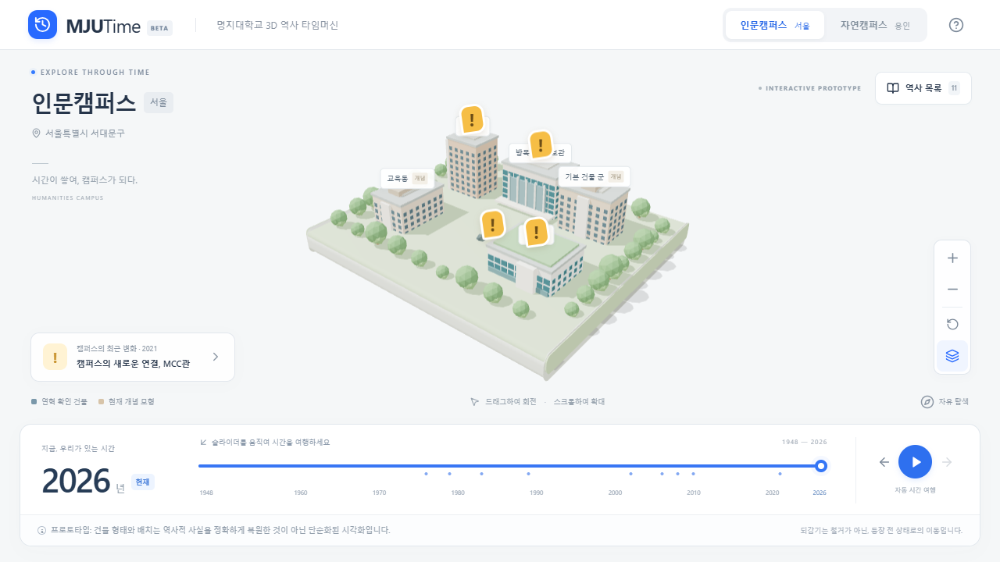

# MJUTime

명지대학교의 역사를 3D 캠퍼스와 인터랙티브 타임라인으로 탐험하는 디지털 타임머신.

배포 주소: https://oyueo-mm.github.io/MJUTime/



React 19 · TypeScript · Vite · Three.js · React Three Fiber · Drei · Tailwind CSS. 정적 사이트이며 계정, 서버, 데이터베이스를 사용하지 않습니다.

## 실행

Node.js 24 LTS와 npm을 사용합니다.

```sh
npm ci
npm run dev
```

http://127.0.0.1:5173/MJUTime/ 에서 실행됩니다.

```sh
npm run typecheck
npm test
npm run build
npx playwright install chromium
npm run test:e2e
```

로컬에 설치된 Edge로 테스트하려면 PowerShell에서 `$env:PLAYWRIGHT_CHANNEL='msedge'`를 설정할 수 있습니다. Playwright는 개발 서버 대신 실제 빌드 결과를 `/MJUTime/` 하위 경로에서 테스트합니다.

## 체험

- 한 손가락/마우스 드래그로 회전, 두 손가락/휠로 확대합니다. 오른쪽 버튼으로 확대·축소·시점 초기화·건물 이름 표시를 조작할 수 있습니다.
- 하단 슬라이더는 1948년부터 한국 시간 기준 현재 연도까지 이동합니다. 이전/다음 사건 버튼과 자동 재생도 지원합니다. 현재에서 재생하면 1948년으로 돌아갑니다.
- 2005 → 2006년에는 인문캠퍼스 생활관이, 2007 → 2008년에는 자연캠퍼스 차세대과학관과 60주년채플관이 등장합니다.
- 노란 느낌표를 선택하면 카메라가 이동하고 공식 출처가 있는 사건 카드가 열립니다. 닫으면 이전 탐색 시점으로 돌아갑니다.
- 역사 목록에서는 과거·미래의 사건을 모두 선택할 수 있습니다. 다른 캠퍼스의 사건은 해당 캠퍼스로 이동합니다. 캠퍼스 선택만 바꿀 때는 연도가 유지됩니다.
- 모바일은 사건 카드를 하단 시트로 표시합니다. WebGL 2가 없으면 연도 슬라이더와 텍스트 목록으로 탐색할 수 있습니다.

## 사료와 표현 원칙

**프로토타입: 건물 형태와 배치는 역사적 사실을 정확하게 복원한 것이 아닌 단순화된 시각화입니다.**

각 연도는 해당 해의 확인된 사건을 모두 포함합니다. 월 정보는 카드에 제공하되 애니메이션은 연도 단위로 동작합니다. 2008년의 두 건물은 함께 표시되지만 실제 개관 월은 서로 다릅니다. 되감기는 실제 철거가 아니라 건물이 등장하기 전 시간 상태로의 이동입니다.

검증된 개관 연도를 가진 다섯 건물과, 신축 연도를 모르는 기본 건물 군을 구분합니다. 기본 건물 군에는 연도를 부여하지 않고 **현재 연도에서만 ‘개념’ 라벨과 함께** 표시합니다. 그 외 과거 시점에는 해당 연도까지 확인된 건물만 보여 줍니다. 1976년 이전 서울, 1979년 이전 용인에는 현존 캠퍼스 건물을 표시하지 않습니다. 지면, 나무, 도로, 광장도 시연용 환경이며 역사적 복원을 주장하지 않습니다. 두 캠퍼스는 별도의 장면입니다.

사건 11개는 요청된 아홉 역사 항목 중 1983년의 두 사건과 2008년의 두 건물 개관을 각각 분리한 것입니다. 행정 사건은 중앙 마커로 표시하며 건물 신축을 유발하지 않습니다. 1948년은 탐색 범위의 시작으로만 사용하고 검증되지 않은 사건을 추가하지 않았습니다.

공식 출처:

- [1963~1983 연혁](https://mjhistory.mju.ac.kr/mjukr/163/subview.do): 1976.01 본부 이전, 1979.07 착공, 1983.03 본부 이전
- [1980~1999 연혁](https://mjhistory.mju.ac.kr/mjukr/162/subview.do): 1983.09 종합대학 승격, 1989.10 계열별 이원화
- [2000~2009 연혁](https://mjhistory.mju.ac.kr/mjukr/161/subview.do): 2002.03 명칭 변경, 2006.02 생활관, 2008.10 과학관, 2008.12 채플관
- [2010~2019 연혁](https://www.mju.ac.kr/mjukr/160/subview.do): 2010.03 방목학술정보관. 제공된 mjhistory 도메인 페이지의 응답이 불안정하여 같은 학교의 공식 www 도메인을 연결했습니다.
- [2020~현재 연혁](https://emc.mju.ac.kr/mjukr/9418/subview.do): 2021.08 MCC관 신축 및 봉헌예배

제공된 `news.mju.ac.kr/news/articleView.html?idxno=1357`은 확인 시 404였으므로 출처 링크에 사용하지 않았습니다. 사진과 외부 3D 모델을 수집하지 않고 기본 Geometry로 모형을 직접 구성했습니다.

## 코드 구조

- `src/data/history.ts`: 사건과 건물 데이터, 출처, 증거 수준, 모형 신뢰도. 위치와 치수는 실측 값이 아닌 3D 장면 단위입니다.
- `src/lib/time.ts`: 연도에 따른 순수 상태 계산. 애니메이션과 분리되어 빠른 역방향 이동에도 최종 상태가 결정론적입니다.
- `src/components/CampusScene.tsx`: 지형·건축물·창문 인스턴싱·마커·카메라. 같은 건물 객체를 유지하고 목표 가시성으로 보간하므로 타임라인 드래그 중 중복 생성이 없습니다. 향후 건물별 GLB 컴포넌트로 교체할 수 있습니다.
- `src/App.tsx`: 타임라인·캠퍼스·재생·이벤트 카드·WebGL 대체 목록.
- `src/lib/time.test.ts`: 개관 경계, 자료 미상, 조기 용인, 반복 이동, 이벤트·출처 무결성.
- `tests/explorer.spec.ts`: 실제 WebGL 장면 상태, A~F 시나리오, 카메라, 출처, 재생, 반응형, 대체 목록을 데스크톱·모바일에서 확인합니다.

작은 화면 또는 CPU 코어 수가 적은 기기에서는 그림자를 끄고 DPR을 제한합니다. OS의 동작 줄이기 설정을 존중합니다. 창문은 건물별 InstancedMesh로 렌더링합니다. R3F 언마운트가 Geometry·Material을 해제하고 효과의 타이머·이벤트 구독도 정리합니다. `window.__MJUTIME_DEBUG__()`는 테스트용 읽기 전용 장면 스냅샷을 제공합니다.

[실행·검증 기록](docs/verification.md)을 참고하세요. 모바일 검증은 Chromium 기기 에뮬레이션과 실제 터치 입력 이벤트로 수행했으며, 실물 iOS·Android 기기 테스트는 포함하지 않습니다.

## GitHub Pages

`vite.config.ts`의 `base`는 `/MJUTime/`입니다. `.github/workflows/deploy.yml`이 main push마다 타입 검사 → Vitest → 빌드 → Chromium 데스크톱/모바일 테스트 → Pages 배포를 수행합니다. PR에서는 검증만 수행합니다.

저장소 **Settings → Pages → Build and deployment → Source → GitHub Actions**를 선택해야 합니다. 관리자 권한이 있는 기존 Git Credential Manager 인증이 있다면 `node scripts/github.mjs configure`로 설명·Topics·Pages 소스를 설정할 수 있습니다. `node scripts/github.mjs status`로 실행 결과를 확인할 수 있습니다. 이 도우미는 인증 정보를 메모리에서만 사용하며 파일이나 출력에 기록하지 않습니다.
