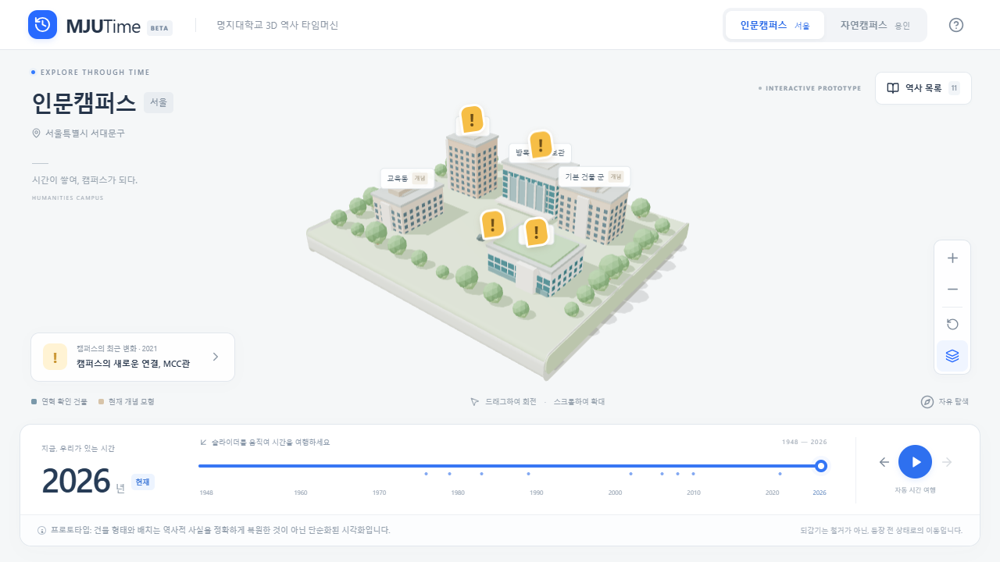
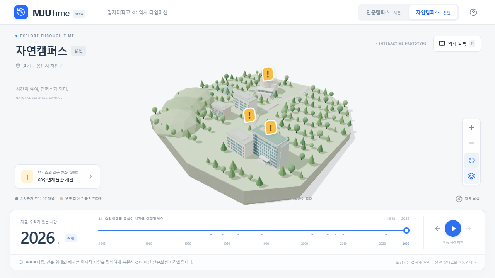

# MJUTime v0.2 모델링 및 검증

검증일: 2026-10-21. 기준 버전 `8ce86ee`. [조사 자료와 원본 URL](BUILDING_REFERENCES.md). 아래 이미지는 직접 구현한 WebGL 장면이며 학교 사진은 재게시하지 않았다.

## 전후 비교

| 이전 | v0.2 인문캠퍼스, 이름표 숨김 |
| --- | --- |
|  |  |

기존 반복 박스형 입면을 건물별 독립 컴포넌트로 교체했다. 공식 사진의 정면·사선 방향을 참고해 모델 카메라를 배치하고 아래 캡처에서 매스·지붕·입면을 육안 비교했다. 촬영 렌즈·위치가 일치하는 정밀 영상 정합은 아니다. 재학생의 식별 평가와 정량 유사도 측정은 수행하지 않았다.

| 건물 | 반영한 특징 | 남은 차이·추정 | 등급 / 자체 캡처 |
| --- | --- | --- | --- |
| 방목학술정보관 | 곡면 U-GLASS의 세로 리브, 열린 상부 띠와 테라스, 목재 매스·원형 기둥·보행교 | 곡률·패널 수·뒤쪽 경계·옥상 상세. 실제 투광 재질 대신 색상 표현 | A / [사선](v02/v02-desktop-library-front-oblique.png) |
| MCC | 좌측 4층 베리타스 매스, 넓은 우측 코이노니아 매스, 중앙 계단·테라스·수직 핀·녹화 지붕 | 지하/지상 레벨, 정확한 지붕 경계와 계단 폭·단수 | A / [전면 사선](v02/v02-desktop-mcc-front-oblique.png) |
| 생활관 | 긴 곡면 벽돌 입면, 흰 상단·저층부, 7개 반복 창 열층과 중앙 유리 | 출입구·옥상·후면 상세, 실제 반경·창 개수. 공식 자료의 층수·월 차이는 조사 문서 참조 | A / [북측 사선](v02/v02-desktop-dorm-front-oblique.png) |
| 60주년채플관 | 백색 곡면 강당, 수평 이음선, 낮은 유리 로비·넓은 전면 계단 | 작은 공식 사진으로는 측면·지붕·곡률 확정 불가. 제한된 근거의 단순화 | B / [전면 사선](v02/v02-desktop-chapel-front-oblique.png) |
| 차세대과학관 | 공식 표기 조감도의 장방형 연구동과 부속 매스, 연혁의 7층 | **고해상도 정면 사진 미확보. 창·입구·옥상은 추정**. 정면 복원 완료를 주장하지 않음 | B / [사선](v02/v02-desktop-science-front-oblique.png) |

비교 후 방목관 상부가 덩어리로 막혀 보이는 부분을 열린 경계로 수정했다. 건물 선택 시 InstancedMesh가 재생성되면서 창·계단 행렬이 초기화되던 문제도 수정하여 선택 전후 입면이 유지되게 했다. 이름표 없는 전체·건물별 데스크톱/모바일 캡처를 `docs/v02/`에 준비했다. 원본 학교 사진은 조사 문서의 링크에서 열어 비교할 수 있다.

## 공간 및 데이터

공식 지도 POI를 캠퍼스별 원점에 투영했다. +X 동쪽 / -Z 북쪽 / +Y 위쪽이며 대략 10m/장면 단위이다. 인문은 MCC 남측, 종합관과 생활관 북측, 학생회관·국제관·방목관 동측, 행정동 정문 옆의 상대 관계를 반영했다. 미래관을 서측에 배치했다. 자연은 채플 북서측과 과학관 남동측을 분리하고, 공학관·함박관과 보행축을 연결했다. 비정형 부지와 수목 군집, 진입로·광장·연못, 남측으로 높아지는 개념적 경사를 추가했다.

POI는 측량된 건물 중심이 아니다. 회전·발자국·높이·도로·대지 경계·지형 고저차는 상대 비율의 추정이다. 자연 장면은 주요 시설 주변의 발췌이며 전체 캠퍼스 복원이 아니다. 종합관 등 외형 B와 교육동 개념 C를 구분하지만, 준공 연도가 없는 모델은 모두 현재 연도에서만 보인다.

건축 데이터(`architecture.ts`)와 역사 연도(`history.ts`, `time.ts`)를 분리했다. 개관 연도 2006/2008/2010/2021과 기존 11개 사건을 보존했다. 모델 외형 변경은 역사적 존재 상태를 바꾸지 않는다. 마커는 건물의 새 위치·높이를 사용하며, 건물 선택·정보 카드에 A/B/C와 출처·관찰·추정을 제공한다. 새 역사 사건은 추가하지 않았다.

## 기능 및 회귀 검증

- TypeScript 검사, 프로덕션 빌드 통과. Vite `/MJUTime/` 유지, 기존 GitHub Actions 보존.
- Vitest **13/13 통과**: 개관 경계·빠른 역방향 이동·자료 미상·초기 용인·출처·모델/시간 분리·좌표·마커 연결.
- Playwright **10/10 통과**: 데스크톱 Chromium 및 Pixel 7 Chromium 에뮬레이션 각각 5개.
- 실제 WebGL 렌더링, 카메라 드래그/휠, CDP 터치 회전·핀치, 마커 터치와 출처, A~F 시나리오, 재생·일시정지·이전/다음 사건, 캠퍼스 전환 시 연도 유지, 리사이즈·화면 넘침, WebGL 대체 목록을 확인했다.
- 건물 위치·회전·단일 모델 시그니처·정보 카드 등급 및 연도 보존, 페이지 오류 부재를 추가 확인했다. 라벨 충돌 회피와 투영 좌표 캐싱으로 클릭 안정성을 개선했다.
- 기존 테스트의 캔버스 제거·장면 자원 해제 검증을 보존했다. 반복 창·계단·핀·나무는 인스턴싱, 건물별 재료 공유, 곡면 Geometry와 재료의 effect 해제 사용. 장시간 메모리 누수 스트레스 테스트는 별도로 수행하지 않았다.

## 측정 성능

로컬 프로덕션 preview, Windows / Intel Arc 140V GPU / ANGLE D3D11. 정착 후 마지막 60 RAF 프레임을 계측했다. 모바일은 같은 데스크톱 GPU의 기기 에뮬레이션이며 실물 스마트폰 성능이 아니다. FPS는 표시 동기화의 영향도 받는다.

| 프로필·캠퍼스 | 평균 FPS | p95 프레임 ms | draw calls | 삼각형 | Geometry |
| --- | ---: | ---: | ---: | ---: | ---: |
| 데스크톱 1280×720 인문 | 60.0 | 17.2 | 81 | 22,701 | 25 |
| 데스크톱 1280×720 자연 | 60.0 | 17.2 | 48 | 16,668 | 17 |
| 모바일 412×839 인문 | 59.9 | 17.1 | 81 | 22,701 | 25 |
| 모바일 412×839 자연 | 60.0 | 17.2 | 48 | 16,668 | 17 |

최초 RAF 시점은 navigation time origin 기준 데스크톱 535ms, 모바일 에뮬레이션 517ms였다. 캐시·회선 통제 벤치마크나 사용자 입력 준비 완료 지표가 아니다. 건물 등장 중 마지막 30프레임은 약 16~17.5ms 범위였다. 원자료: [desktop](v02/desktop-performance.json), [mobile](v02/mobile-performance.json). `renderer.info`의 호출·삼각형은 해당 프레임의 값이며 GPU 실행 시간 측정은 하지 않았다. 실제 iOS/Android·Safari·Firefox 검증은 수행하지 않았다.

빌드 산출물: CSS 29.62kB, 앱 JS 32.69kB, 캠퍼스 장면 22.69kB, R3F 장면 라이브러리 417.61kB, Three 703.85kB(모두 비압축). 기존 지연 로딩을 유지했다. Three chunk 500kB 경고는 남아 있으며 기능 오류는 아니다.

## 배포

기존 main → 타입 검사·단위 테스트·빌드·브라우저 테스트 → GitHub Pages 흐름을 사용한다. 커밋·워크플로·공개 사이트 검증 결과는 최종 작업 보고의 링크를 참조한다. 저장소에 학교 사진·외부 모델·인증 정보는 포함하지 않는다.
