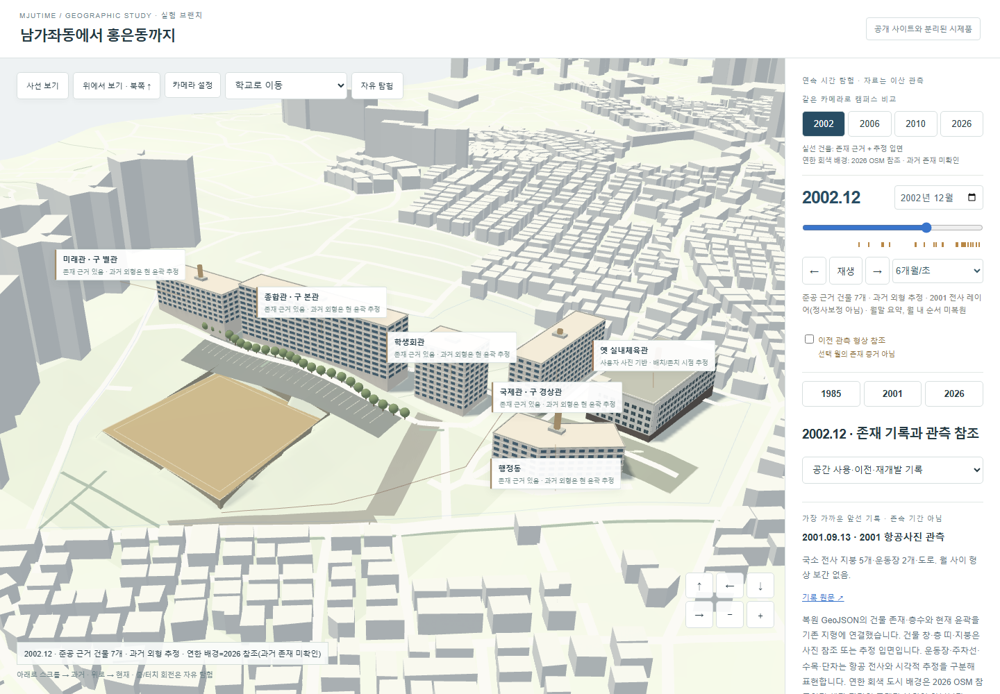
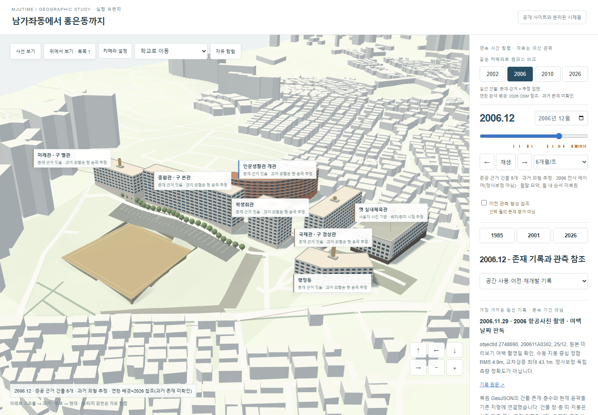
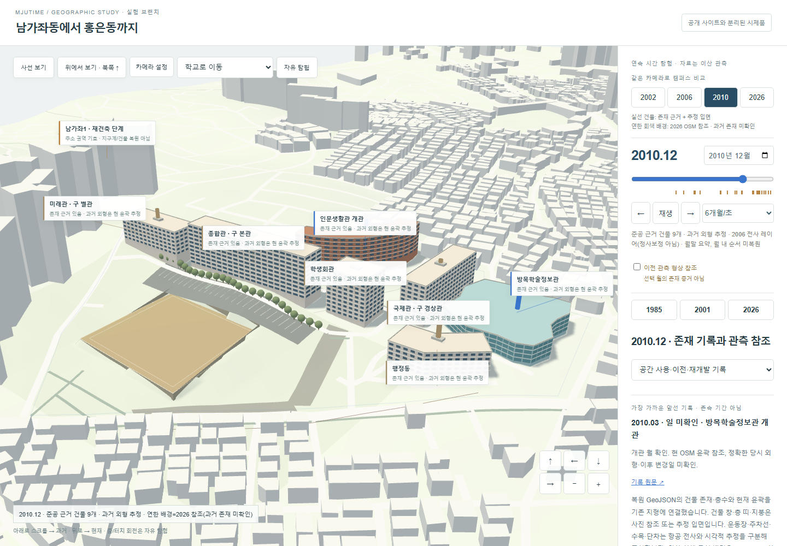
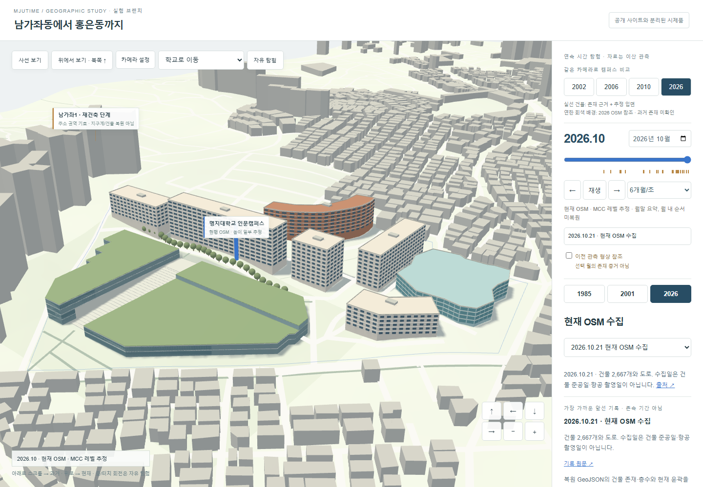

# 2006 캠퍼스 통합 · 화면 평가

최종 장면은 **기존 `geography.html`**이다. `restoration.html`은 기존 자료 검토용으로 그대로 두었다. 새 지도/검토 화면은 만들지 않았다. 기본 진입은 2006.12, 캠퍼스 사선 카메라다. 전체 지역은 기존 사선 보기 버튼으로 탐험할 수 있다.

| 2002 · 생활관 이전 | 2006 · 생활관 + 체육관 추정 |
| --- | --- |
|  |  |
| 2010 · 별도 윤곽의 방목학술정보관 | 2026 · 운동장 권역 대신 MCC |
|  |  |

위 네 장은 같은 카메라·대상점이다. [체육관 확대](screenshots/integrated-desktop-gym-detail.png) · [모바일 2006](screenshots/integrated-mobile-2006.png). 사용자 원사진은 공개 자산/저장소에 포함하지 않았다.

## 화면에서 달라진 것

독립된 황토색 매스 대신 실제 좌표의 지형·OSM 도시·기존 도로 위에서 교사, 운동장, 주차 공간과 진입로가 함께 읽힌다. 종합관 등의 창·층 띠·옥상 경계, 벽돌색 곡선 생활관, 유리색 도서관을 넣어 건물의 구분을 높였다. 데스크톱에는 캠퍼스 한정 부드러운 그림자를 적용하고, 모바일은 그림자를 줄이며 더 넓은 구도로 맞췄다. 운동장은 항공 전사 윤곽을 토대로 평탄면과 지반 접합을 표현했다.

**주변의 연한 회색 건물·도로는 2026 OSM 공간 참조이며, 2006년에 존재한 주택가로 검증한 결과가 아니다.** 배경을 끄면 근거 건물·사진 추정 모델만 남는다. 실제 옛 동네의 세밀한 복원이 완성되었다고 평가하지 않는다. 운동장 평탄 표고, 주차선 배치, 수목과 입구 세부는 시각적 추정이다.

## 체육관 사진 분석과 추정 경계

사용자 제공 세 PNG를 직접 열어 확인했다. 촬영일·치수·원 출처 URL은 미확인이다. 파일명/해시/픽셀 크기와 이미지 미배포 조건만 `data/old-gym-photo-audit.json`에 남겼다. Google Earth 영상이나 그 파생 데이터는 사용하지 않았다.

| 직접 관찰한 요소 | 모델링 가정 |
| --- | --- |
| 밝은 흰 외벽, 어두운 저층부, 저층 위 약 4줄의 창, 긴 입면의 반복 창과 세로 기둥, 넓은 평지붕·난간·돌출 코너부 | 외관상 5개 층 구분을 사용하되 법정 층수로 확정하지 않음 |
| 철거 사진의 콘크리트 지붕/바닥판 | 길이 60~80m, 폭 28~42m, 높이 18~23m의 가정 범위 안에서 70×34×20m 모델 |
| 행정동과 함께 보이는 포장 외부 공간 | 도서관 권역 안 배치·방향·독립 직사각 외곽은 추정. 현재 도서관 다각형을 복사하지 않음 |
| [명대신문 1139호](https://news.mju.ac.kr/news/articleView.html?idxno=13137)의 1972 완공·도서관 부지 교체 서술(검색 색인; 직접 링크 404) | 2002/2006 존치는 **비교 시나리오 추정**. 사진이 그 해 촬영됐다고 주장하지 않음. 2007~2009 철거/공사 시기는 미확인 |

도서관의 2010.01 대장 준공과 03 개관은 기존 데이터대로 분리했다. 체육관이 2007.01에 철거됐다고 기록하지 않았다. 모델을 숨기는 시나리오 경계와 실제 철거 사건은 별개다. 원 파이프라인의 미확인 체육관 GeoJSON(`geometry:null`)도 그대로 유지했다. 새 사진 기반 모델은 별도 추정 계층이며 확정 기록으로 승격하지 않았다.

## 데이터 연결과 접합

- 네 `restoration/generated/campus-*.geojson`을 기존 엔진에서 직접 읽는다. 현재 파일들은 같은 현 윤곽 참조를 사용하므로 가장 최근 유효 윤곽을 모델 템플릿으로 쓰고 준공/개관 근거로 월별 존재를 판정한다. 2002/2006/2010/2026 버튼은 날짜만 바꾸며 카메라를 초기화하지 않는다.
- 기존 OSM 병합 모델에서 통합 모델이 담당하는 윤곽을 제외해 같은 건물이 두 번 생기지 않는다. MCC는 기존 전용 모델을 유지한다. 시간에 따른 존재, 형상/입면, 높이, 운동장/지형 상태는 각각 별도 데이터/모듈이다.
- 몸체의 하단 정점을 DEM에 닿도록 내리고 지붕은 수평으로 유지한다. 운동장만 명시적 추정 평탄면을 사용한다. 실제 과거 지형·옹벽의 측량 복원은 아니다.
- 같은 기하/머티리얼을 재사용한다. 창은 건물/재질별로 병합하고 주차선은 한 LineSegments로 묶었다. 세로 스크롤, 날짜 입력, 재생, WASD·Q/E·마우스·모바일 탐험은 유지한다.

입면 참고: [현 종합관 사진](https://klec.mju.ac.kr/images/gallery/3.jpg), [생활관 사진](https://klec.mju.ac.kr/images/gallery/6.jpg), [도서관 사진](https://klec.mju.ac.kr/images/gallery/4.jpg). 현재 사진의 외장을 과거에 그대로 확인했다는 뜻이 아니다. 사진을 텍스처로 쓰지 않았고 반복 창 간격·일반 건물 옥상 설비는 추정이다.

검증·성능 결과는 RESULTS 최상단에 기록한다. 실제 스마트폰·Safari·Firefox는 미검증이다.
