# 지리·역사 공간 실험 · 2026-10-22

## 최신 · 2026-10-23 지도 버그와 전용 건축 모델

**2026.10에서 09로 돌아가도 현대 참조 도시가 유지된다.** 현재 OSM 배경은 날짜와 무관한 독립 토글이고, 준공 근거 건물·기관 이전·사업 단계는 별도다. 미확인 배경의 과거 존치를 주장하지 않는다. 캔버스 우클릭 메뉴만 막고 PAN은 유지했다.

**방목은 열린 상부 공간을 가로지르는 유리 띠, MCC는 두 홀·중앙 계단·옥상 운동장이 구분된다.** 일반 압출 모델을 전용 건축 기하로 보완했다. 공식 사진에서 보이는 구조를 반영했지만 곡률·구간 분할·치수·표고는 여전히 추정이다. [사진 출처 ↔ 자체 렌더링 비교와 정확도](ARCHITECTURE_REVIEW.md).

현대 지도는 기본 상시 이름표 대신 메시 호버·모바일 탭 팝업을 쓴다. 드래그 중에는 숨기고 클릭/탭은 상세를 고정한다. 시간 구간을 건너면 위치별 `!`가 나오며 준공·개관·이전·신고를 구분한다. 체육관 전환은 철거 월을 만들지 않고 시기 미확인으로 표시한다.

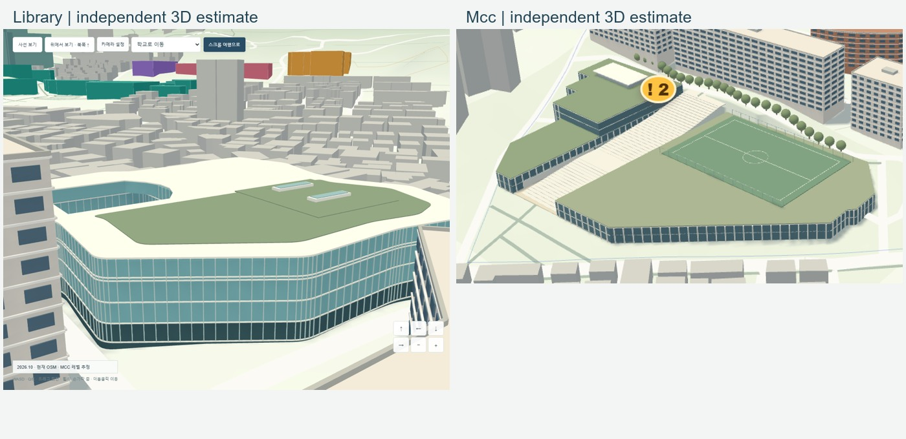

[공식 사진 링크와 렌더링을 나란히 비교](ARCHITECTURE_REVIEW.md) · [같은 카메라 네 시대](screenshots/integrated-four-epochs.jpg). 실제 사진을 합친 로컬 대조 이미지는 `.preview/architecture-photo-render-comparison.jpg`에만 두고 GitHub에는 업로드하지 않았다. 방목의 외부 보행교 전체, MCC의 정확한 전면 단면·성큰 표고는 미완성이며 실측 복원 완료로 보지 않는다.

검증: 실험 Vitest30·기존13·복원 Node22/Python4 통과. 브라우저 12개 시나리오 통과(전체11 + 캡처 지연으로 시간 초과된 데스크톱 월별1개 단독 재검증). 최종 라벨 보완 후 데스크톱/모바일 8개 시대 화면에서 같은 카메라·체육관/도서관 전환·라벨/마커 겹침 0·콘솔 오류 0을 추가 확인했다. 두 앱의 타입 검사·빌드 통과. [데스크톱 시각 감사](screenshots/visual-audit-desktop.json) · [모바일 시각 감사](screenshots/visual-audit-mobile.json).

현재 기본 뷰 61 draw calls·157,608 triangles. 지오메트리를 재사용하고 이동/변화 최대30fps·정지12fps로 제한하며 그림자 캐시를 재사용한다. headless 표본 FPS는 데스크톱 약8.6~13.2, 모바일 에뮬레이션 약12.5~17.8이고 프레임 제한·전환 구간·로컬 GPU 부하가 포함된다. 실기기·Safari·Firefox·최대 GPU 성능은 미측정이다. `main`·Pages·배포 workflow 변경 없음. 사전 generated 로컬 변경은 보존하고 커밋하지 않는다.

---

## 최신 · 2006 캠퍼스를 기존 지도에 통합

**이제 `geography.html` 한 장면에서 지형·도시·도로 위의 캠퍼스를 탐험한다.** 복원 파이프라인의 네 GeoJSON을 연결하고, 기본 화면을 2006년 캠퍼스로 맞췄다. 운동장·주차 공간·진입로·수목과 창·층 띠·옥상을 넣은 교사, 곡선 생활관, 사진 기반 체육관이 함께 보인다. 2010년에는 별도 형상의 도서관, 2026년에는 운동장 권역의 MCC로 변화한다. `restoration.html`은 원래 자료 검토용으로 유지했다.

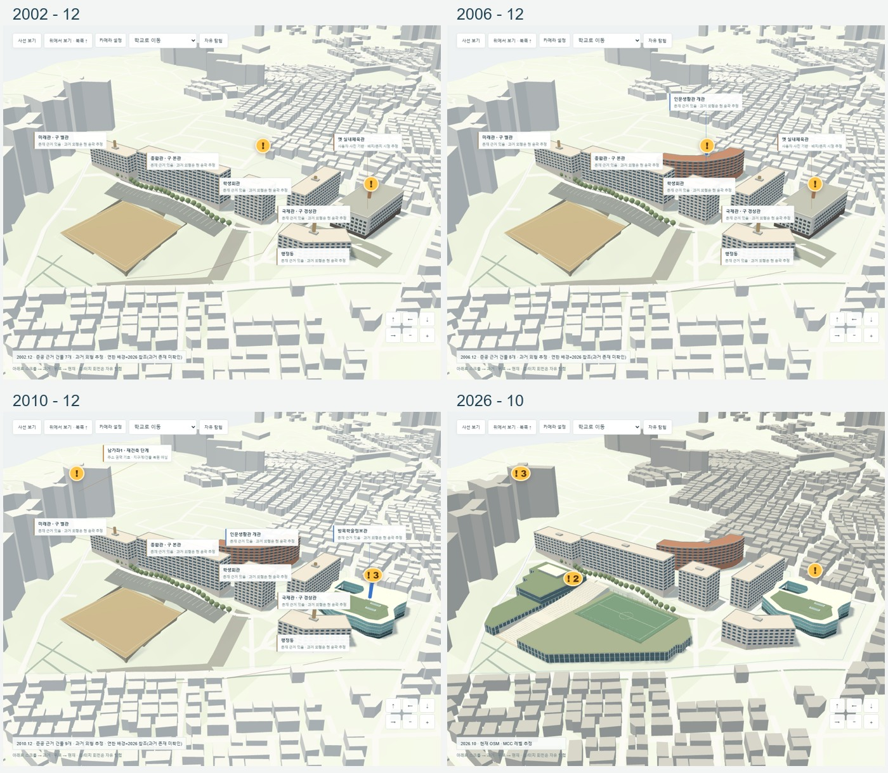

[2006 원 크기](screenshots/integrated-desktop-2006.png) · [옛 체육관 확대](screenshots/integrated-desktop-gym-detail.png) · [모바일 2006](screenshots/integrated-mobile-2006.png) · [사진 관찰/추정/연동 방식](INTEGRATION.md).

**정확도 평가:** 체육관은 사용자 사진 3장을 직접 확인해 흰 외벽·어두운 저층부·반복 창·평지붕·코너부를 별도 모델로 만들었다. 도서관 외곽을 복사하지 않았다. 사진 촬영일과 치수가 없어 **2002/2006 존치·배치·5개 외관 층 구분·높이는 추정**이다. 2007~2009의 정확한 철거/공사는 미확인이고, 모델 전환일을 철거일로 기록하지 않았다. 사진 자체는 로컬에만 두었다.

**주변 회색 도시와 도로는 2026 OSM 참조이며, 과거 개별 주택의 존재를 확인한 복원이 아니다.** 역사 캠퍼스와 도시 맥락을 한 공간에서 볼 수 있게 되었지만, 과거 동네 전체를 Google Earth 수준으로 복원한 결과는 아니다. 운동장 평탄 표고·주차선·식재·사진 없는 입면 세부도 추정이다.

검증: 동일 카메라 네 시대·실제 모델 생성/제거·체육관/도서관 비중복(되감기 중 포함)·DEM 하단 접합·스크롤·카메라·모바일 터치·빠른 시간 변경을 확인했다. 지리 실험 Vitest 27개, Playwright 10개 통과 후 마지막 중복 윤곽/계단 정리의 영향 범위 4개를 추가 재검증했다. 기존 앱 Vitest 13개·타입/빌드, 기존 복원 Node 22개·Python 4개 통과. 프로덕션 `/MJUTime/` 경로 3D 확인 및 콘솔 오류 없음. 실제 스마트폰·Safari·Firefox 미검증.

[데스크톱 측정](screenshots/integrated-desktop-measurements.json) / [모바일 에뮬레이션 측정](screenshots/integrated-mobile-measurements.json)은 각 시대 1초 headless 표본이며 실기기 성능이 아니다. 창·주차선 병합 및 기하 재사용을 적용했고 모바일 그림자는 끈다. `main`·공개 Pages·배포 workflow 변경 없음. 기존 generated 데이터의 사전 로컬 변경은 덮어쓰지 않았다.

---

아래는 이전 개선 기록이다.

## 이번 개선 · 과거 캠퍼스 존치와 세로 스크롤 여행

**2000년에도 주요 건물 5개가 보인다.** 촬영 월만 표시하던 구조를 수정하고 건물의 존재·개관·사용기관·형상 관측을 분리했다. [공식 시설 현황 PDF 10쪽](https://ice1.mju.ac.kr/bbs/mjukr/147/146375/download.do)을 시각 확인해 종합관(1971), 학생회관(1982), 미래관·국제관(1982), 행정동(1997)의 준공일을 기록했다. 정확한 월·일은 데이터에 보존했다. **과거 매스는 현재 윤곽·층고 추정**이며 사진 전사와 색상으로 구분한다. 방목의 2010.01 준공과 03 개관도 별도다.

| 2000 · 준공 근거 + 현재 윤곽 추정 | 2016 · 운동장·서측 나지 전사 | 2026 · MCC 단차 모델 |
| --- | --- | --- |
| 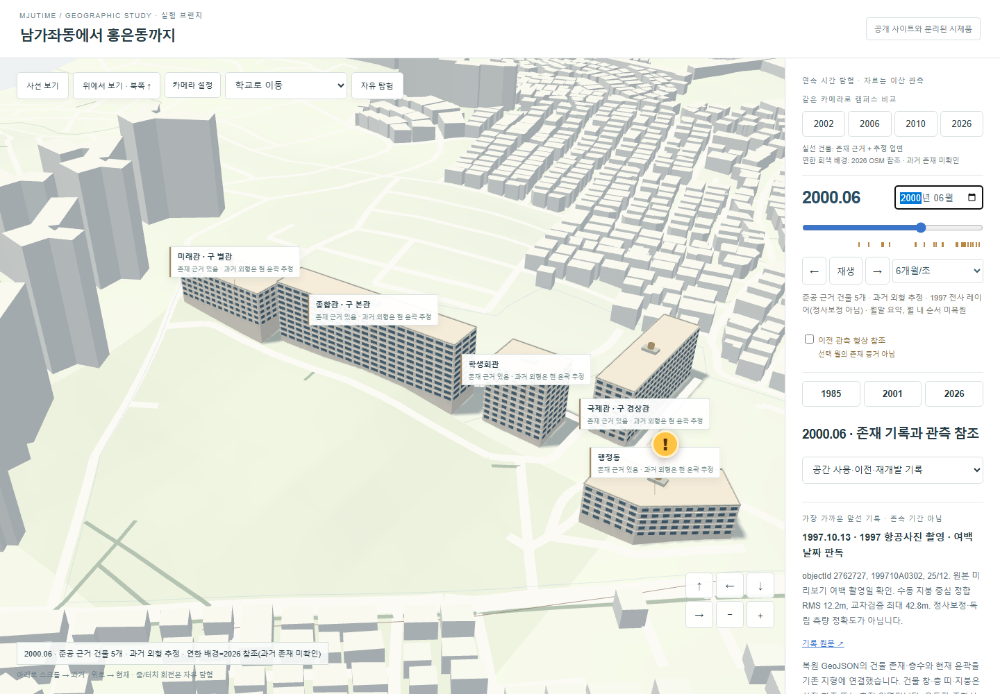 | 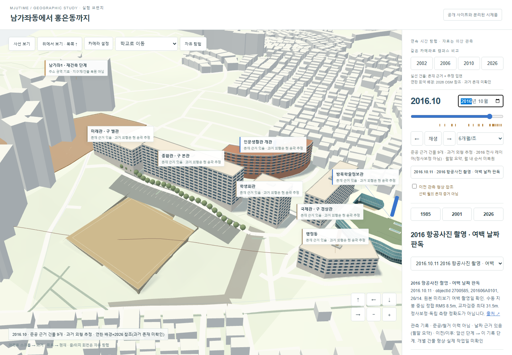 | 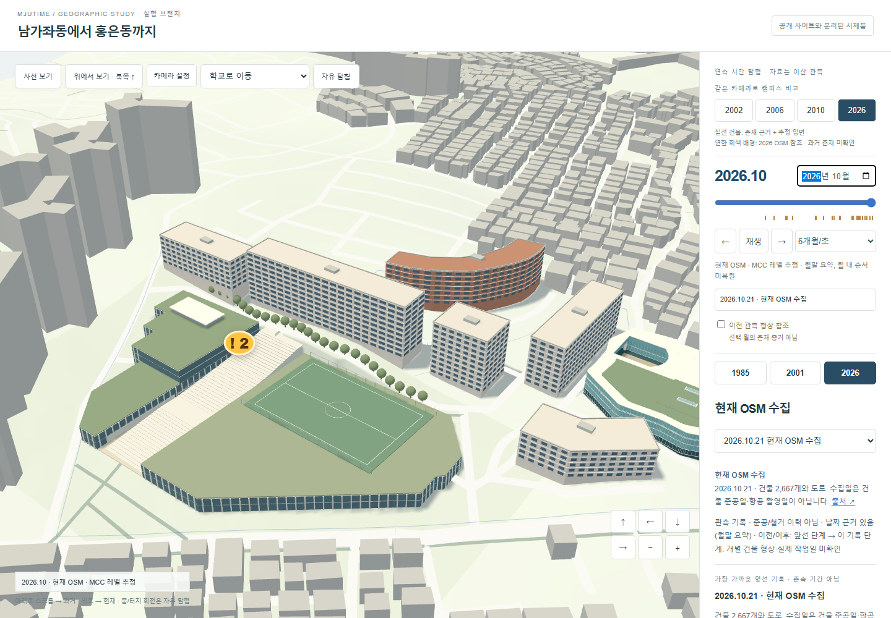 |

시대별: [1985](screenshots/desktop-story-1985.png) · [1990](screenshots/desktop-story-1990.png) · [2001](screenshots/desktop-story-2001.png) · [2010](screenshots/desktop-story-2010.png) · [2020](screenshots/desktop-story-2020.png). [모바일 2000](screenshots/mobile-story-2000.png) · [모바일 현재](screenshots/mobile-story-2026.png). 전부 자체 3D 렌더링이며 원사진은 재배포하지 않았다.

[7개 시대 한눈에 비교](screenshots/epoch-comparison.jpg). 프로덕션 실험 빌드의 `/MJUTime/geography.html`에서도 실제 3D·2000년 건물 5개·MCC 전환·콘솔 오류 없음을 별도로 확인했다.

- **항공사진:** [국토정보플랫폼](https://map.ngii.go.kr/ms/map/Aerial.do) 실제 영상 여백에서 1997.10.13 / 2006.11.29 / 2016.10.11을 확인했다. 전사·대조점·행렬·해시는 `data/additional-registration.json`, 재현은 `register_additional.py`. 대조점 제외 최대 오차 31~43m의 국소 아핀 실험이며 정사복원·측량 정확도가 아니다. 2016 목록 코드에서 촬영 월을 추론하지 않았다.
- **MCC:** [공식 소개](https://emc.mju.ac.kr/mjukr/9418/subview.do), [실제 전면 사진](https://www.mju.ac.kr/CrossEditor/binary/images/000155/20230613144401594_PFNCBGFT.png), 대장의 B2/2F, [주차 진입 층 안내](https://ice1.mju.ac.kr/bbs/ice1/1157/229501/artclView.do)를 참고했다. 단일 박스에서 두 홀·계단·옥상·낮은 광장과 국소 지반으로 변경했다. **홀 경계·층고·선큰 깊이·표고 접합은 추정**이고 정확한 지하 단면 복원은 미완성이다.
- **여행:** 아래로 현재→과거, 위로 과거→현재. 날짜·자동 재생·사건 탐색과 스크롤이 동기화된다. 자유 탐험 버튼으로 휠 줌/터치 회전과 시간 스크롤을 분리했다. WASD·Q/E·정밀 이동·감도·학교 이동은 유지했다.
- **도시/기관:** 국제대학 사용·초교/전문대 이전·정비사업 단계는 보존했다. 2016 서측 나지는 영상 관측만 반영했으며 특정 사업지구·철거일로 확정하지 않았다. 운동장·도로는 관측 사이 참조, 주택 지붕·나지는 촬영 월만 표시한다. 이전을 옛 건물 철거로 처리하지 않는다.

검증: 실험 Vitest **21개** + 기존 **13개**, 타입 검사·실험/기존 빌드, 실험 Playwright **8개** 및 기존 앱 **10개** 통과. 기존 건물 비교 테스트 1개는 두 WebGL 테스트 동시 실행 중 60초 시간초과 후 단독 재실행에서 15.6초 통과했다. 7개 시대의 건물 존치·월 경계·스크롤 왕복·날짜/재생 동기화·자유 카메라·모바일 스와이프·MCC 지형 왕복·콘솔 오류를 확인했다.

성능: 현재 화면 2초 headless Chromium 표본 **데스크톱 16.2fps / 모바일 에뮬레이션 20.2fps**, 18 draw calls, 139,304 triangles, 렌더러 기하 65/64개, 항공 그룹 5개. [원 측정 desktop](screenshots/desktop-performance.json) / [mobile](screenshots/mobile-performance.json). 실제 기기 GPU 수치가 아니며 스마트폰 성능을 보증하지 않는다. 연속 월 변경은 기존 기하·5개 항공 캐시를 재사용하며 MCC 패치도 버퍼를 교체하지 않고 경계에서만 수정한다. 실험 빌드 JS gzip 약 382KB(OSM·Three.js 포함). 모바일은 그림자 없이 DPR 최대 1.75로 렌더링한다.

[복원 근거·오차·남은 일](RESTORATION_NOTES.md), [재개 지점](PROGRESS.md). 실제 스마트폰·Safari·Firefox 미검증. `main`·공개 Pages·배포 워크플로 변경 없음.

---

아래는 이전 실험 기록이며 이번 개선 이전의 표시 제한/측정값이다.

**월 타임라인 개선:** 연도·월 슬라이더와 날짜 입력, 자동 재생(1/6/24/120개월/초), 사건 눈금·이전/다음·선택 이동을 추가했다. 기존 관측 버튼·카메라·터치·이전선은 보존했다. 기본 회전/팬/줌/WASD 감도는 0.5×이고 개별 설정·저장, Alt 정밀 이동을 지원한다.

| 홍은2 철거완료 기록 · 2019.08 | 착공 참조 격자 · 2019.10 | 공사완료 기록 · 2022.11 |
| --- | --- | --- |
| 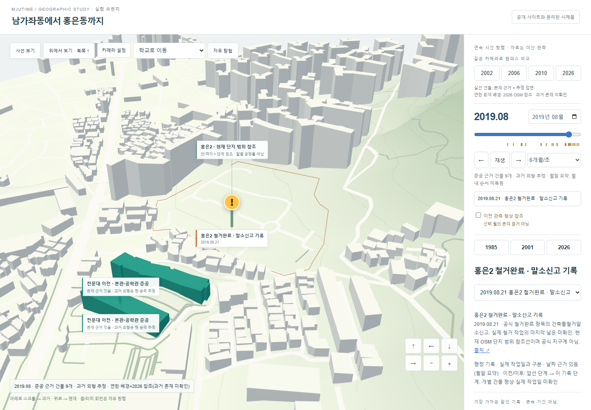 | 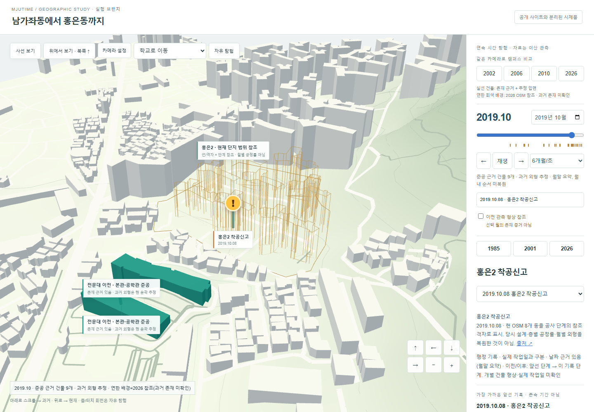 | 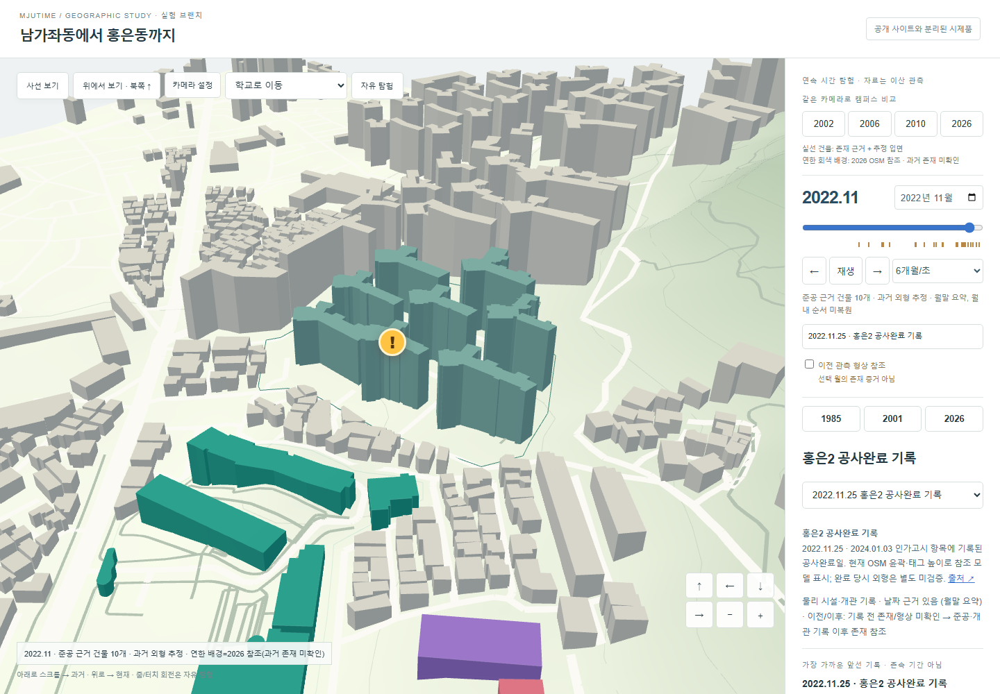 |

[생활관 등장 월](screenshots/desktop-month-2006-02.png) · [모바일 착공 단계](screenshots/mobile-hong2-2019-10.png). **격자·완료 매스는 현재 OSM 8개 동의 참조 형상이며 당시 공정률·외형의 복원이 아니다.** 현재 단지 경계 `1126398129`도 공식 정비지구계가 아니다. 옛 건물별 윤곽·철거일은 없어 임의 생성하지 않았다.

| 추가 조사 원문 | 보존한 시간과 시각화 범위 |
| --- | --- |
| [홍은2 공식 추진경과](https://cleanup.seoul.go.kr/cafe/mainIndx/cleanup-prtnelapse/vscr.do?bsnsPk=11410-100010002&cafeId=410100010002o22), [구청 준공인가 고시](https://www.sdm.go.kr/news/notice/notice.do?mode=view&sdmBoardConfSeq=82&sdmBoardSeq=288669), [서울시 공급위치 안내](https://news.seoul.go.kr/welfare/archives/511046) | 홍은동338-5, 힐스테이트 홍은포레스트. 2019.04.03 철거멸실신고 / 08.21 철거완료 항목의 말소신고 / 10.08 착공신고 / 2022.11.25 공사완료 기록 / 2023.12.29 준공인가 / 2024.01.03 인가고시. 완료일은 후일 고시의 회고 기록이며 신고일을 실제 작업일로 확정하지 않았다. |
| [남가좌1 공식 추진경과](https://cleanup.seoul.go.kr/cafe/mainIndx/cleanup-prtnelapse/vscr.do?bsnsPk=11410-100008009&cafeId=410100008009I86), [공식 위치도](https://cleanup.seoul.go.kr/cafe/mastr-cleanup-bsnsSumry/execute.do?cafeId=410100008009I86&div=locImage&stepSeCode=103) | 2010.02.11 철거신고 / 2016.05.12 착공신고 / 2018.10.30 공사완료 기록 / 10.31 사용허가 / 12.31 준공인가 / 2019.01.02 인가고시. 이전에는 공고만 확인했으나 이번에 추진경과를 추가 확인했다. 지적 좌표·건물별 대응 미확정으로 **주소 권역 추정 위치의 3D 단계 기호**만 표시한다. |
| [홍은13 공식 추진경과](https://cleanup.seoul.go.kr/cafe/mainIndx/cleanup-prtnelapse/vscr.do?bsnsPk=11410-100003003&cafeId=410100003003O20) | 2020.07.30 철거신고 / 2021.07.25 착공신고 / 2025.06.25 완료 기록 / 2026.09.04 인가·09.09 고시. 현재 DEM/OSM 범위 밖으로 목록만 제공한다. 07.25는 신고 이력이며 소식지의 07.15 실제 착공 서술과 구별한다. |
| [국토정보플랫폼 추가 열람](https://map.ngii.go.kr/ms/map/Aerial.do) | 1997 objectId2762727 (`199710A0302`, 25/12), 2006 objectId2748690 (`200611A0302`, 25/12) 영상을 공식 화면에서 열람해 운동장·지붕·주변 시가지를 확인했다. 프레임 날짜·좌표 정합 미완료로 **목록 연도만 보존, 촬영 월·일 null**, 3D 전사·월 보간 없음. 2016 objectId2700614 (`201606A0101`, 27/15)는 목록만 확인했으며 선택 영상이 표시되지 않았다. 상세는 [추가 항공자료](data/additional-aerial.json). 사진 재게시 없음. |

월 단위 시간은 자료의 해상도를 높이지 않는다. 월이 없는 연도 기록은 1월 사건으로 바꾸지 않으며, 국제대학의 사용 기간 말단도 만들지 않았다. 공식 개관 월이 있는 전문대 본관·공학관/생활관/방목/MCC 5개는 **개관 후 존치 가정·현 윤곽 참조**로 표시한다. 1985.10/2001.09 촬영 월 이외에는 항공 형상이 미확인이다. 사용자가 이전 관측 참조를 켜면 낮은 불투명도로 구분한다. 등장·되감기 애니메이션은 상태 표현이며 역사적 월별 공정 보간이 아니다.

성능: 월 입력을 프레임마다 한 번으로 합치고, 두 항공 전사 그룹을 각각 한 번만 생성해 재사용한다. 건물·주거동도 미리 생성한 메시의 상태만 변경한다. 연속 시간 변경 48회에서 데스크톱 2.475초/모바일 에뮬레이션 2.094초, 변경 후 양쪽 모두 렌더링 기하 60개·전사 그룹 생성 2회였다. 현재 MCC 근접 화면 2초 표본은 19.9/24.9fps, 14/11 draw calls, 125,868/125,304 triangles다. headless Chromium 측정이며 실제 기기·GPU 시간으로 일반화하지 않는다. 실험 JS gzip 약377KB(OSM 포함).

최종 검증: 실험 Vitest **17개** + 기존 **13개**, 실험 Playwright **6개** + 기존 **10개** 통과. 월 경계·개관 전후·재생/정지/속도/끝점·자료 해상도·재개발 단계·빠른 변경과 자원 재사용·감도 저장·모바일 터치/핀치/슬라이더·기존 시간 여행을 확인했다. 타입 검사와 두 프로덕션 빌드 통과. 실제 스마트폰·Safari·Firefox는 미검증. main·기존 공개 사이트·배포 설정 변경 없음. 아래는 이전 스냅샷 버전의 조사·검증 기록이다.

`experiment/geographic-history` 전용. **main·공개 사이트·배포 워크플로는 변경하지 않는다.** 실행: `npm run dev:geo` → http://127.0.0.1:4188/MJUTime/geography.html

| 1985 항공사진 국소 전사 | 2001 전문대 이전 | 현재 MCC 권역 |
| --- | --- | --- |
| 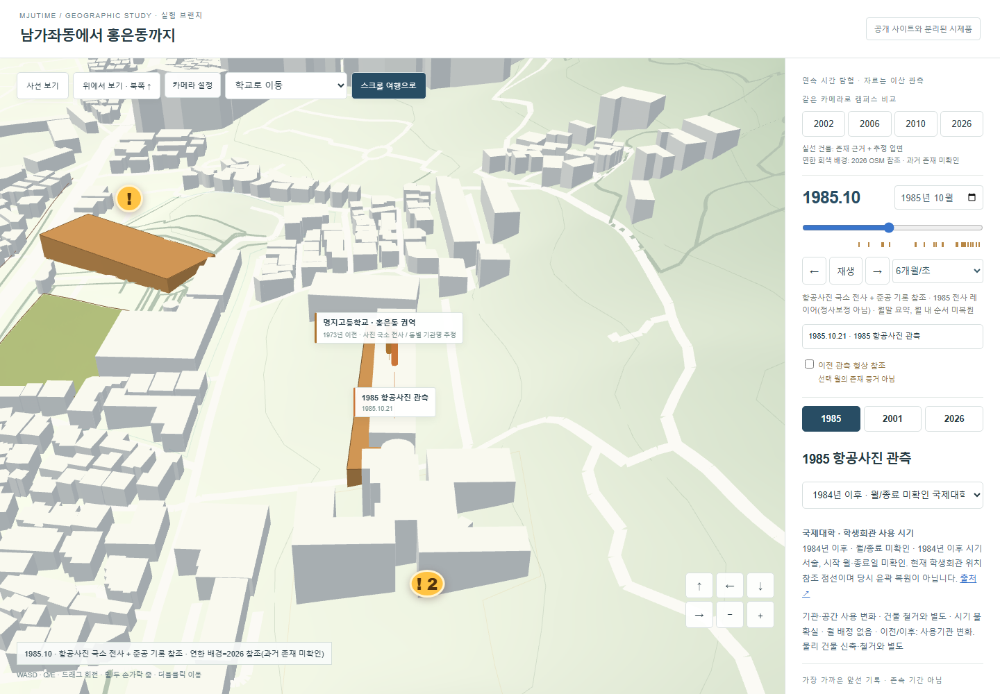 | 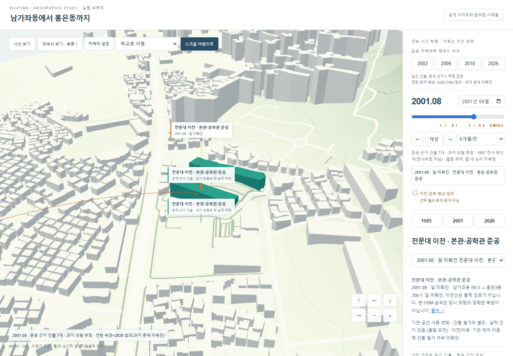 | 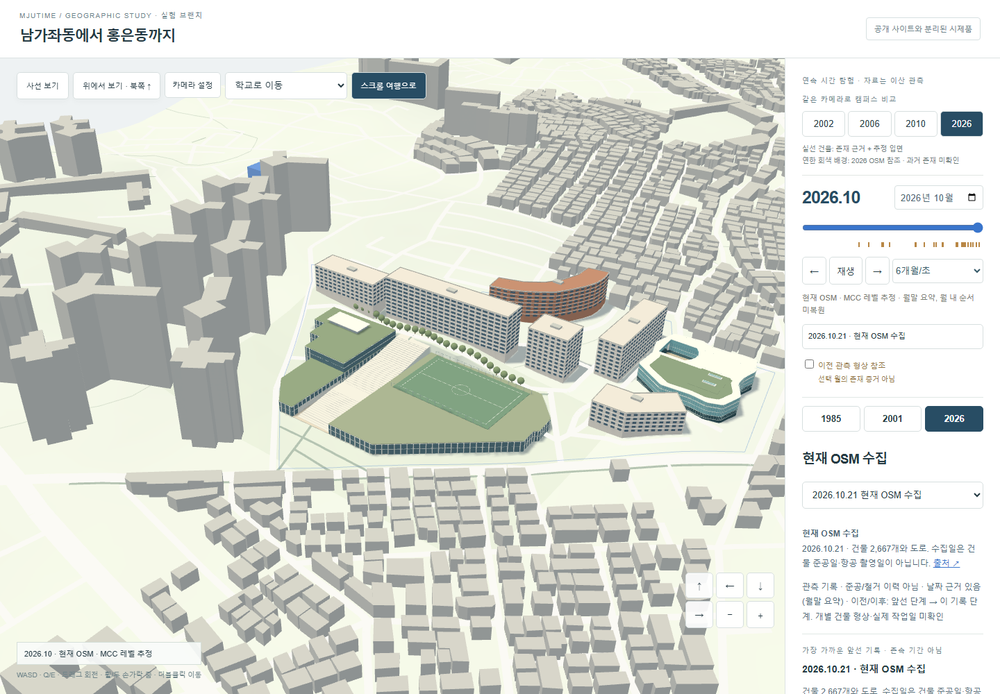 |

[1985 국제대학 사용 기록](screenshots/desktop-1985-occupancy.png) · [2001 운동장](screenshots/desktop-2001-field.png) · [현재 전체](screenshots/desktop-2026.png) · [북쪽 위](screenshots/desktop-2026-top.png) · [모바일](screenshots/mobile-2026-mcc.png). 사진 원본은 재배포하지 않으며 캡처는 자체 렌더링이다.

| 개선 | 구현·정확성 범위 |
| --- | --- |
| 자유 탐험 | 지도에 초점을 두고 WASD, Q/E 높이, Shift 가속. 드래그 회전·우클릭 이동·휠 확대·더블클릭 지면 이동. 학교 5곳 바로 이동 시 연도 유지. 모바일 한 손가락 회전·두 손가락 확대/이동·방향 버튼 길게 누르기. |
| 현재 지도 | 독립 수집 OSM 건물 2,667개·도로 1,262개 연결 조각·학교 5곳과 DEM. +X 동쪽, −Z 북쪽, 원점 126.9265/37.58275, 미터 단위. 벽 하단을 DEM에 접합하고 운동장 면을 세분화해 경사면 가림을 수정했다. 옹벽·절토면·최신 지형은 미복원. 도로 폭은 종류별 표현값이다. |
| 주요 건물 점검 | OSM 종합관 `462990137`, 방목 `462990139`, 학생회관 `462990141`, 생활관 `462990142`, MCC `1127358152`, 전문대 본관 `795977922`·공학관 `1123968177`, 중·고 교사 `463033409/463033408` 확인. **기존 MCC 누락 설명은 잘못되어 정정했다.** 초교 권역의 이름 없는 교사 후보 `780472249`를 임의 실명·과거 교사로 확정하지 않았다. 중·고 윤곽은 학교 부지 전체가 아니다. |
| 1985 실제 3D | 사진에서 홍은동 지붕 2개·운동장 1개·도로 중심선 1개를 수작업 전사. 동별 사용기관·현재 건물과의 구조 연속성은 미확인. 남가좌동 대학은 선택 사진 프레임 밖이므로 과거 건물을 생성하지 않았다. |
| 2001 실제 3D | 남가좌동 지붕 2개·운동장, 홍은동 지붕 3개·운동장, 진입로 중심선 전사. 현재 MCC 권역과 2001 운동장 위치를 비교할 수 있다. 당시 도로 폭·건물 높이는 미확인이다. |
| 국제대학 | 명대신문의 1984년 이후 학생회관 사용 기록을 1985 비교에 표시. 선택하면 **현재** 학생회관 위치를 점선으로 참조한다. 당시 윤곽·점유 경계·정확한 사용 종료일로 주장하지 않는다. |
| 기관 이전 | 2001.08 전문대와 1997.06 초교 이전을 출발 권역→현재 주소 권역의 3D 이동선으로 표시. 통학로가 아니며 옛 경상관 등의 확정 좌표가 아니다. 이전을 신축·철거로 해석하지 않는다. |
| 도시 재개발 | 2015 남가좌1 공고를 별도 도시 변화 기록으로 유지. 검증된 지구계·개별 철거/완공일을 확보하지 못해 과거 아파트나 도로를 임의 생성·삭제하지 않는다. |

**정합 결과와 한계:** 정사영상이 아닌 공개 스캔 미리보기다. SIFT 자동 정합은 안정적인 대응점이 부족해 기각했다. 수동 국소 아핀의 대응점·행렬·잔차는 [JSON](data/aerial-registration.json), 재생성은 `python experiments/geography/register_aerial.py`(numpy)이다. 폭 1100px 미리보기 좌표를 사용한다.

- 2001→OSM: 지붕 중심 6개, 적합 RMS **5.77m**, 하나씩 제외한 검증 최대 **23.61m**. 현재 OSM와 수동 지붕 중심의 대응값이며 독립 측량 정확도가 아니다.
- 1985→2001: 같은 두 지붕의 모서리 8개, RMS **1.99px**, 하나씩 제외 시 최대 **4.98px**. 같은 지붕 모서리끼리 상관되어 있고 공간 범위가 좁다. 도시 전체 정합으로 해석하면 안 된다.
- 지형·지붕 시차·렌즈 왜곡을 보정하지 않았다. 25m 주의 범위도 통계적 오차 보증이 아니다. **지붕 높이는 null, 3m는 표시용 돌출**, 지반은 현재 DEM이다. 빈 곳은 미조사 영역이다. 기관·동 이름 대응은 사진 관찰과 분리해 추정으로 기록했다.

| 실제 열람·근거 | 식별자 / 반영 |
| --- | --- |
| [국토정보플랫폼 항공사진](https://map.ngii.go.kr/ms/map/Aerial.do) | 1985: objectId `2662182`, `198510A0302`, 코스21/사진6, 원사진 날짜 **1985.10.21** 판독. 2001: `2729075`, `200109A0301`, 코스25/사진12, **2001.09.13** 판독. 카탈로그 코드만으로 날짜를 추정하지 않았다. |
| [1985 공개 미리보기](https://map.ngii.go.kr/search/airImage.do?file_nam=198510030200210006&air_type=air&zone_code=198510A0302&ph_course=21&ph_num=6) / [2001 공개 미리보기](https://map.ngii.go.kr/search/airImage.do?file_nam=200109030100250012&air_type=air&zone_code=200109A0301&ph_course=25&ph_num=12) | 지붕·운동장·도로 판독. 다른 인접 프레임도 열람했으나 대학 부지의 신뢰할 만한 1985 윤곽은 확보하지 못했다. 사진을 저장소 자산으로 포함하지 않는다. |
| [명대신문 2010 현장 기사](https://news.mju.ac.kr/news/articleView.html?idxno=1357) | 네 기관의 당시 공간 사용. 검색 색인 본문을 확인했으나 현재 직접 링크는 404여서 영구 열람성에 한계가 있다. 정확한 동별 지적 경계는 미확인. |
| [전문대 공식 2000년대 연혁](https://www.mjc.ac.kr/ibuilder.do?menu_idx=84&per_menu_idx=12&tabCnt=6) | 2001.08 남가좌동50-3→홍은3동356-1, 본관·공학관·주차장 준공. 09.13 항공사진은 이전 이후다. 이전 기록과 사진 지붕의 세부 동 식별은 별개다. |
| [초교 공식 역사](https://www.myongji.net/subpage.php?p=m15) / [법인 연혁](https://emc.mju.ac.kr/mjuins/4388/subview.do) | 1976.02.28 남가좌동, 1997.05.16 신축, 06.09 이전. 중학교 이전 날짜는 자료 차이로 미확정. |
| [현재 기관 주소](https://emc.mju.ac.kr/mjuins/4390/subview.do) / [고교 학술 연혁](https://encykorea.aks.ac.kr/Article/E0018395) | 현 위치 및 1973 홍은동 이전 참고. 당시 모든 건물의 존재 증거로 확대하지 않는다. |
| [서울시 남가좌1 공고](https://cleanup.seoul.go.kr/cleanup/bidpblanc/vscr.do?cpage=1201&othbcListSn=306781&searchCode=SJ&searchValue=&signguCd=) | 2015 재건축 감리 공고만 확인, 지구계·개별 철거일 미확인. |
| [OSM](https://www.openstreetmap.org/#map=16/37.58275/126.92650) / [DEM](https://registry.opendata.aws/terrain-tiles/) | 수집 2026.10.21, 원본 SHA·ID·범위는 current-map.json. OSM © contributors / ODbL. DEM z13 Terrarium 6984/3171·3172, 약15~244m·배율1, Mapzen / USGS SRTM·GMTED. 172개만 height 태그, 나머지 층수×3m 또는9m 표현값. |
| [mju-landing](https://mju-landing.vercel.app/) / [공개 소스](https://github.com/coalfire-create/mju-landing) | 이전 조사 유지: Three.js+GSAP/Lenis, 평면 지면, OSM 가공 데이터. LICENSE 부재로 코드·가공 JSON을 복사하지 않고 OSM API에서 독립 수집했다. |

검증: 실험 Vitest **8개**, 기존 Vitest **13개**, 실험 Playwright **4개**, 기존 Playwright **10개** 통과. 타입 검사·실험/기존 프로덕션 빌드 통과. 실험 Chromium 데스크톱·Pixel7에서 회전·키보드 높이·휠·더블클릭·터치 이동/핀치·연도 반복·점유 기록·이전선·가로 넘침과 오류를 확인했다. 실제 스마트폰·Safari·Firefox·독립 측량 검증은 수행하지 않았다. 과거 도시 전체 복원은 완료되지 않았다.

렌더링 표본(현재 MCC 근접 화면, headless Chromium / ANGLE SwiftShader 소프트웨어 렌더러, 2초 단일 표본): 데스크톱 **41프레임/2.067초 ≈19.8fps, 13 calls/125,832 triangles**, Pixel7 에뮬레이션 **48프레임/2.050초 ≈23.4fps, 10 calls/125,268 triangles**. 서로 화면에 보이는 요소가 달라 calls 차이가 있다. 실제 기기 FPS·GPU 시간·초기 로딩 벤치마크로 일반화하지 않는다.
