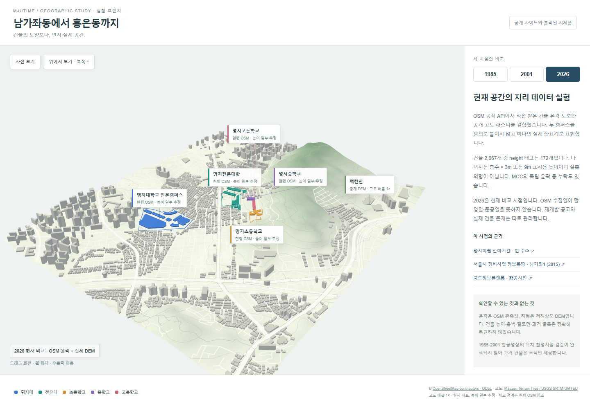
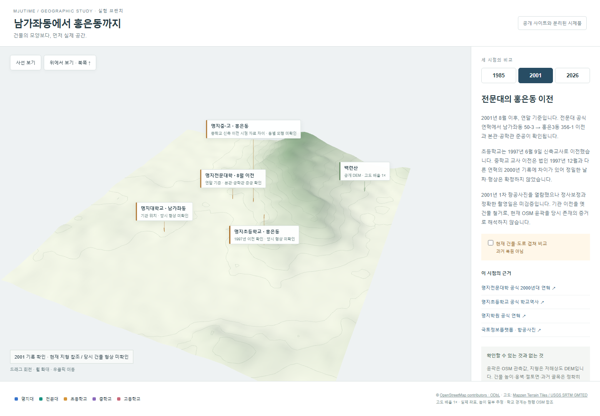
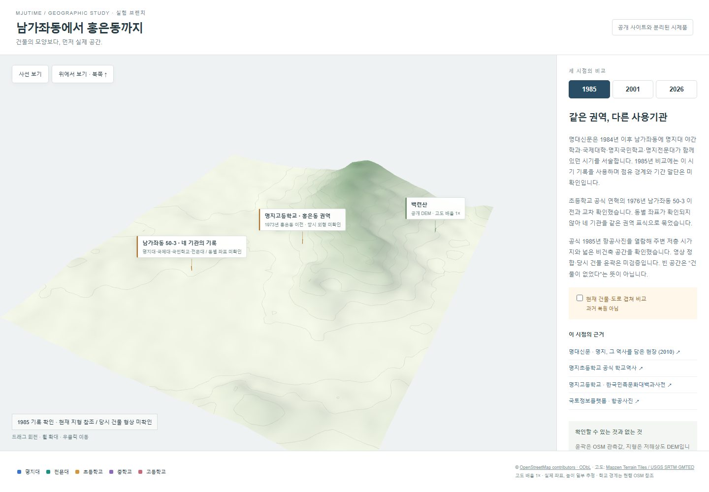

# 실제 공간 실험 · 2026-10-21

**방향:** 현재 공간은 OSM+DEM으로 개선할 수 있다. 과거는 기관 연혁만으로 건물 형상을 복원할 수 없으며, 항공사진 정합이 먼저 필요하다. 미확인 건물을 만드는 대신 위치 기록만 표시했다.

| 현재 2026 비교 | 2001 연말 기록 | 1985 시기 기록 |
| --- | --- | --- |
|  |  |  |

[북쪽을 위로 본 현재 지도](screenshots/desktop-2026-top.png) · [모바일](screenshots/mobile-2026.png). 학교 사진·항공사진은 재배포하지 않았다.

| 조사 | 확인 결과와 적용 한계 |
| --- | --- |
| [mju-landing](https://mju-landing.vercel.app/) / [공개 소스](https://github.com/coalfire-create/mju-landing) | Three.js + GSAP/Lenis, 번들에 서울 건물 1,220개·도로 304개와 용인 데이터를 포함. OSM 윤곽 압출, 공식 학교 표식 매칭, 일부 누락 윤곽 생성·기본 높이 적용. 지면은 평면, DEM 없음. 소스 기준 `c2f6530`; 저장소 homepage는 별도 Vercel 별칭이므로 배포 커밋 일치는 확정하지 않음. **LICENSE 없음**: 코드/가공 JSON 복사 없이 OSM 공식 API에서 독립 수집. OSM 데이터는 ODbL 조건으로 이용 가능. |
| 현재 실제 지리 | [OSM 추출 범위](https://www.openstreetmap.org/#map=16/37.58275/126.92650): 동경 126.916~126.937, 북위 37.5735~37.592. 건물 2,667개, 도로 1,262개 연결 조각, 다섯 교육기관. OSM ID·원본 SHA·수집일 보존. 172개 height 태그, 나머지는 층수×3m 또는 9m 표시용 높이. 현행 OSM이 2026년 항공 촬영을 뜻하지 않음. |
| 실제 고도 | [Terrain Tiles](https://registry.opendata.aws/terrain-tiles/), z13 Terrarium 6984/3171·3172. 샘플 범위 약 15~244m, 고도 배율 1×. 백련산 사면과 학교·주거지 관계 표시. 저해상도 SRTM/GMTED 기반으로 미세 절토면·옹벽·현재 학교 평탄면은 부정확. |
| 1985 기관 사용 | [명대신문 2010 기사](https://news.mju.ac.kr/news/articleView.html?idxno=1357): 1984년 이후 한 권역에 야간학과(본관)·국제대학(학생회관)·국민학교(옛 사회교육원 자리)·전문대(당시 경상관)가 있던 시기. 정확한 점유 기간 말단과 동별 좌표는 미확인. 1985년에 단정적인 동별 모형을 만들지 않고 권역 표식으로 묶음. |
| 초등학교 이전 | [학교 공식 역사](https://www.myongji.net/subpage.php?p=m15): 1976.02.28 남가좌동 50-3 이전 → 1997.05.16 신축교사 준공 → 1997.06.09 이전. [법인 연혁](https://emc.mju.ac.kr/mjuins/4388/subview.do)의 홍은동 이전과 교차 확인. 2001에는 홍은동 기관 위치만 반영. |
| 전문대 이전 | [공식 2000년대 연혁](https://www.mjc.ac.kr/ibuilder.do?menu_idx=84&per_menu_idx=12&tabCnt=6): 2001.08 남가좌동 50-3 → 홍은3동 356-1, 본관·공학관·지하주차장 준공. 2001은 이전 이후 연말 기준. 옛 부지 건물 철거를 유추하지 않음. |
| 중·고등학교 | [법인 현 주소](https://emc.mju.ac.kr/mjuins/4390/subview.do), [고등학교 학술 연혁](https://encykorea.aks.ac.kr/Article/E0018395)의 1973 홍은동 이전 참조. 중학교 신축 이전은 법인 1997.12와 공개 2000년 기록이 달라 날짜를 확정하지 않음. 현재는 OSM 실재 윤곽, 과거는 권역·형상 미확인 표식. |
| 도시 재개발 | [서울시 남가좌1 2015 공고](https://cleanup.seoul.go.kr/cleanup/bidpblanc/vscr.do?cpage=1201&othbcListSn=306781&searchCode=SJ&searchValue=&signguCd=): 남가좌동 369-10 일대 주택재건축 공고 확인. 사업 경계·개별 철거/준공일을 확보하지 않아 과거 주택을 임의 생성·삭제하지 않음. 학교 이전 데이터와 별도 관리. |

**항공사진 실제 열람:** 구 서울 aerogis 도메인은 DNS 조회 실패. [현재 서울 지도](https://map.seoul.go.kr/smgis2/smap/XrMap)의 항공사진 연결을 따라 [국토정보플랫폼](https://map.ngii.go.kr/ms/map/Aerial.do)에서 ‘명지대학교’ → 인문캠퍼스 → 연도 필터 → 사진 체크박스의 공개 미리보기를 열었다. 신청·개인정보 입력·유료 발급은 하지 않았다.

| 열람 영상 | 식별자 | 육안 확인 / 반영 범위 |
| --- | --- | --- |
| 서울특별시청 1985년 2차 | objectId `2662182`, zoneCode `198510A0302`, 코스21 / 사진6 | 저층 주거 블록과 넓은 비건축 공간 확인. 학교별 동 식별·좌표 정합은 미완료. |
| 서울특별시청 2001년 1차 | objectId `2729075`, zoneCode `200109A0301`, 코스25 / 사진12 | 캠퍼스 주변 저층 블록·운동장 형태 확인. 영상 프레임·방향·지도와의 위치 오차를 확인해 정밀 윤곽으로 전사하지 않음. |

사진 목록의 `year`와 사업명·코드가 다른 사례도 있었다(2001 목록에 2000년 2차 사업명, `200202` 코드 등). 코드만으로 촬영일을 추정하지 않았다. **1985·2001 정밀 3D 복원은 미완료**이며, 현재 도로·윤곽의 소급 표시는 기본적으로 꺼져 있다. 다음 정확도 개선에 필요한 것은 사진별 촬영일 확인·좌표 정합·측량/지적자료이지 추가 임의 모델링이 아니다.

검증: 기존 Vitest 13개 + 실험 Vitest 5개, 타입 검사·별도 빌드, 데스크톱/Pixel7 Chromium 2개 브라우저 테스트 통과. 실제 WebGL·2,667개 윤곽·다섯 학교·마우스/터치 회전·연도 변경·과거 현행건물 숨김·비교 오버레이·가로 넘침 확인. 실물 스마트폰·Safari·Firefox 미검증. 기존 공개 사이트·main·배포 설정은 변경하지 않았다.
